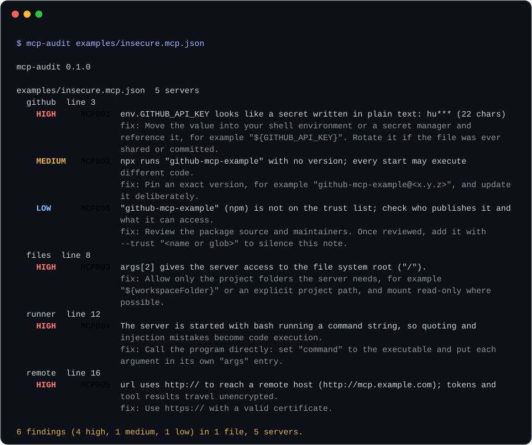

# mcp-audit
[](https://github.com/YusufBeratZengin/mcp-audit/actions/workflows/ci.yml) [](https://www.npmjs.com/package/mcp-audit) [](LICENSE) [](package.json) [](package.json)

[English](README.md) | [Türkçe](README.tr.md)

Audit MCP server configurations for exposed credentials, unpinned packages and risky access.
Offline, zero runtime dependencies; reads JSON/JSONC without starting servers or modifying configurations.
Install from a local checkout: `npm install --ignore-scripts --no-audit --no-fund`
Try it: `node bin/mcp-audit.mjs examples/insecure.mcp.json --no-color`



## Demo

Run these commands from the checkout root:

```sh
node bin/mcp-audit.mjs examples/insecure.mcp.json --no-color
node bin/mcp-audit.mjs examples/insecure.mcp.json --format json --fail-on none
node bin/mcp-audit.mjs examples/insecure.mcp.json --format sarif --output is/report.sarif --fail-on none
```

The first command deliberately exits **1** because the synthetic example has high-severity findings. Its actual summary is:

```text
6 findings (4 high, 1 medium, 1 low) in 1 file, 5 servers.
```

The terminal image is generated from this real output by `npm run demo`; tests detect a stale image.

## Install

Requires Node.js **20+**; Node 24 is recommended for development and coverage checks. This checkout is version 0.1.0. Registry publication and package-name availability have not been verified; the npm badge is not a release guarantee.

Use the local install command above, then `npm run build` to regenerate the included TypeScript declarations. Installation only adds development tools; the CLI and JavaScript API can run directly without installing anything. No build is needed to execute the CLI.

## Usage

### CLI

```sh
node bin/mcp-audit.mjs --help
node bin/mcp-audit.mjs --list-rules
node bin/mcp-audit.mjs . --no-user
```

With no paths, known project and user configuration files are discovered. Use `--no-user` to inspect only the current project. Explicit file paths inspect just those files. A directory checks its three known project locations without recursing into other projects. Use `--` before filenames starting with a dash.

Exit codes: **0** = no finding meets the threshold (also used for empty discovery, with a stderr note); **1** = findings at or above the threshold; **2** = usage, configuration read/parse, or report write error. Read errors take precedence over findings; `--fail-on none` does not suppress them.

### Library

The package exports an ESM API with TypeScript declarations:

```js
import { auditText } from 'mcp-audit';
const result = auditText('{"mcpServers":{"remote":{"url":"http://mcp.example.com"}}}', 'config.json');
console.log(result.findings[0].ruleId); // MCP005
```

`auditText(text, file, { ignore?, trust? })` returns `{ servers, findings }` and throws on invalid JSON. `audit({ paths?, cwd?, home?, platform?, env?, ignore?, trust?, user? })` returns `{ files, findings, errors, summary }`; errors are collected, not thrown. `summary` contains file/server/finding counts and `bySeverity`.

Each finding includes `ruleId`, `ruleName`, `severity`, `message`, `fix`, `file`, `line`, `server`, `scope` and optional `field`. Lines are 1-based, or 0 when unavailable. Additional exports: `discover`, `knownLocations`, `extractServers`, `display`, `RULES`, `SEVERITIES`, `meets`, `formatText`, `formatJson`, `formatSarif`, `VERSION`. Formatters return strings; `formatText` accepts `{ color: true }`.

## Examples

Run the [library example](examples/api.mjs):

```sh
node examples/api.mjs
```

Actual output (this example ignores MCP006):

```text
high     MCP001 github: env.GITHUB_API_KEY looks like a secret written in plain text: hu*** (22 chars)
medium   MCP002 github: npx runs "github-mcp-example" with no version
high     MCP003 files: args[2] gives the server access to the file system root ("/").
high     MCP004 runner: The server is started with bash running a command string, so quoting and injection mistakes become code execution.
high     MCP005 remote: url uses http:// to reach a remote host (http://mcp.example.com)

5 findings in 1 file
```

[examples/insecure.mcp.json](examples/insecure.mcp.json) uses fictional data and reserved example domains. Never copy real credentials into a bug report.

## Configuration / options

| Option | Default | Effect |
|---|---|---|
| `-f, --format text\|json\|sarif` | `text` | Human-readable, structured JSON, or SARIF 2.1.0 |
| `--fail-on low\|medium\|high\|critical\|none` | `high` | Lowest severity causing exit 1 |
| `--ignore MCP001,MCP006` | none | Skip rule IDs; case-insensitive, repeatable |
| `--trust "@example/*"` | built-in list | Add package-name globs for MCP006 registry findings; repeatable |
| `--no-user` | user discovery enabled | Skip user files during automatic discovery |
| `-o, --output file` | stdout | Write report; parent directory must exist |
| `--no-color`, `--color` | TTY detection | Override ANSI output; otherwise honors presence of `NO_COLOR` |
| `--list-rules` | — | Print rule descriptions and exit |
| `-h, --help`, `-v, --version` | — | Help or version and exit |

No configuration file for the auditor is required. `--trust` suppresses only registry provenance notes, never git/URL warnings or other rules. The built-in trust list reduces noise; it does not certify a publisher.

### Known locations

| Scope / client | Location |
|---|---|
| Claude Code project | `.mcp.json` |
| Cursor project | `.cursor/mcp.json` |
| VS Code workspace | `.vscode/mcp.json` |
| Claude Code user | `~/.claude.json` (including per-project entries) |
| Cursor user | `~/.cursor/mcp.json` |
| Windsurf user | `~/.codeium/windsurf/mcp_config.json` |
| Claude Desktop Windows | `%APPDATA%/Claude/claude_desktop_config.json` |
| Claude Desktop macOS | `~/Library/Application Support/Claude/claude_desktop_config.json` |
| Claude Desktop Linux community builds | `$XDG_CONFIG_HOME/Claude/claude_desktop_config.json` |
| VS Code user Windows | `%APPDATA%/Code/User/mcp.json` |
| VS Code user macOS | `~/Library/Application Support/Code/User/mcp.json` |
| VS Code user Linux | `$XDG_CONFIG_HOME/Code/User/mcp.json` |

On Linux, `XDG_CONFIG_HOME` defaults to `~/.config`. On Windows, `APPDATA` defaults to `~/AppData/Roaming`. Discovery is a finite list of candidates: client paths may change. Windsurf, Linux community builds and VS Code user locations are marked `believed` in `knownLocations()` rather than verified client guarantees. Pass files explicitly for other clients, profiles or locations. Nested `mcp.servers` in a settings file is supported when that file is explicitly passed.

## How it works

JSON/JSONC parsing → normalization of client server maps → six independent rules → sorted findings and fix suggestions. `mcpServers`, `servers`, `mcp.servers` and Claude Code `projects` containers are supported. No commands or servers in the inspected configuration are executed.

| ID | Detects |
|---|---|
| MCP001 | Plaintext secrets in env, headers, arguments and endpoints |
| MCP002 | Unpinned npm/Python packages and container images |
| MCP003 | Root, home, system or credential-directory access |
| MCP004 | Shell wrappers and known command-execution servers |
| MCP005 | Unencrypted non-local HTTP/WebSocket connections |
| MCP006 | Git/URL installs and unfamiliar registry publishers |

See [rule details, severity exceptions and fixes](docs/rules.md).

## Limitations / privacy

This is a static heuristic linter, not a vulnerability database or proof that a server is safe. It does not resolve environment variables, inspect installed code, follow arbitrary shell scripts, check registry signatures or validate client configuration schemas. Unknown containers and malformed server entries are ignored. Shell parsing and source locations are best-effort; complex wrappers or repeated names can reduce accuracy. Container tags count as pinned although tags can move; prefer digests.

All auditing is local; no network requests, telemetry or configuration writes. Recognized credentials are masked; parse errors omit input excerpts, and transport/provenance messages omit endpoint paths and install URLs. Reports still identify configuration paths, server names and fields; review reports before sharing them. Secret detection cannot recognize every possible credential. The CLI writes only the report explicitly requested with `--output`.

## Development

After local installation:

```sh
npm run check
npm run test:coverage
npm run demo
npm pack --dry-run --ignore-scripts
```

`check` runs ESLint, strict JavaScript type checking, declaration generation and tests. Tests discover every `*.test.mjs` recursively, run offline in one process, and put temporary fixtures under ignored `is/`. `test:coverage` requires Node 22+ and enforces **85% lines, branches and functions** for all `src/` modules. CI tests Ubuntu and Windows on Node 20/22/24 and enforces coverage on Node 24. `npm run build` regenerates `types/` from JSDoc; include refreshed declarations when changing the API.

## Contributing

See [CONTRIBUTING.md](CONTRIBUTING.md), [security reporting](SECURITY.md) and the [code of conduct](CODE_OF_CONDUCT.md). Add detection and false-positive tests for new rules.

## License

[MIT](LICENSE) © 2026 Yusuf Berat Zengin.
